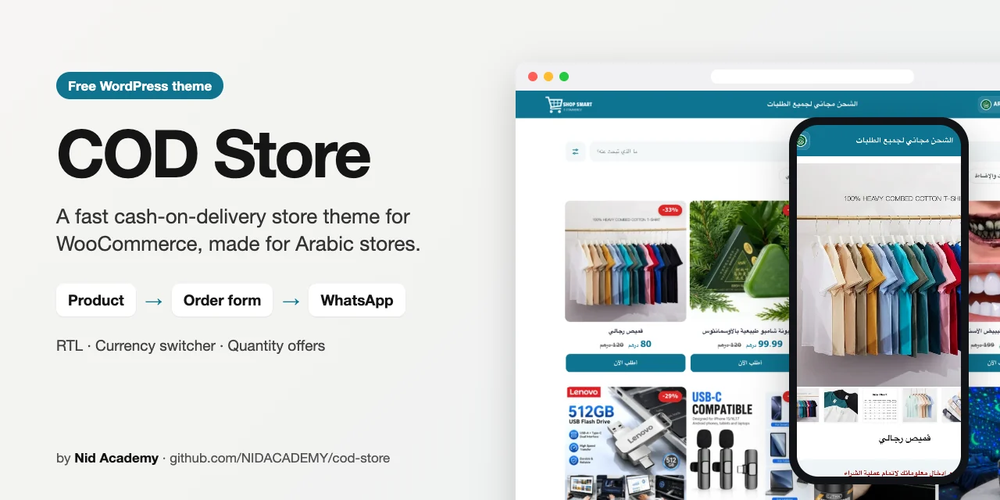
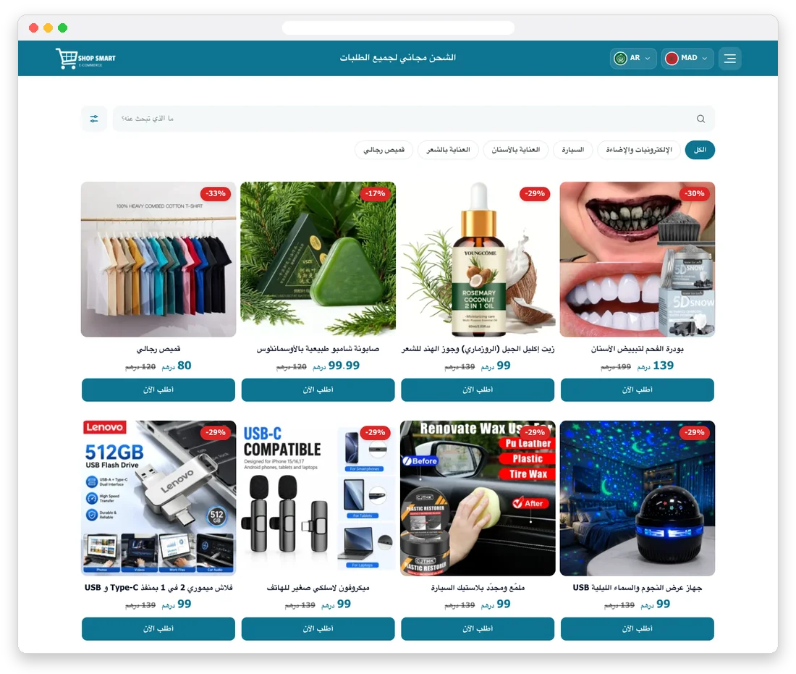
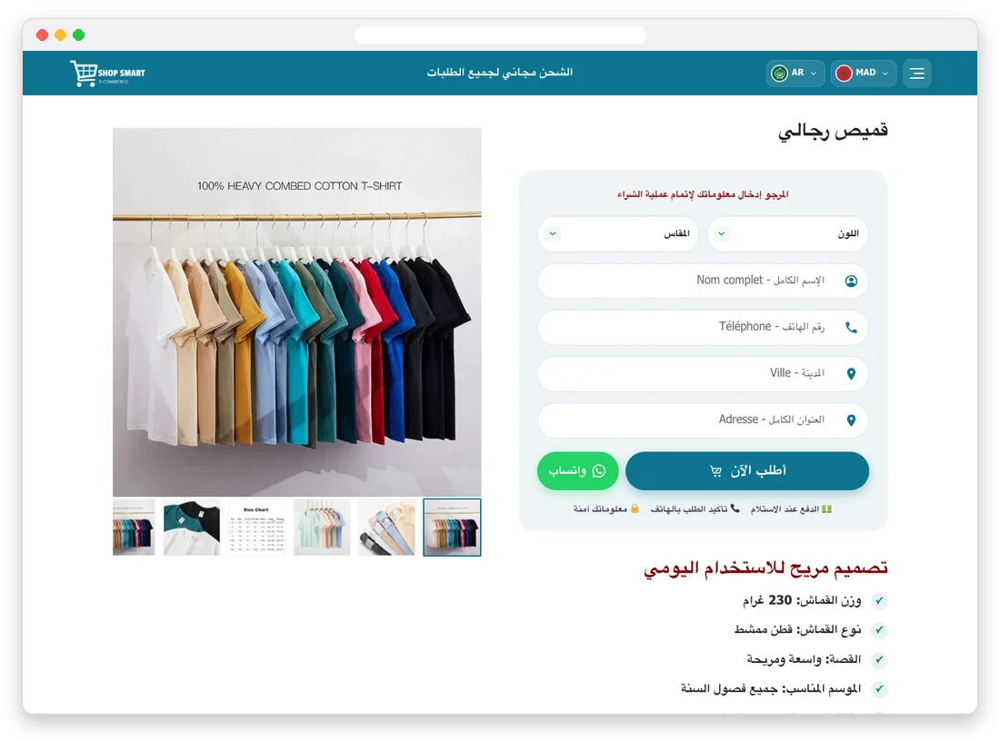
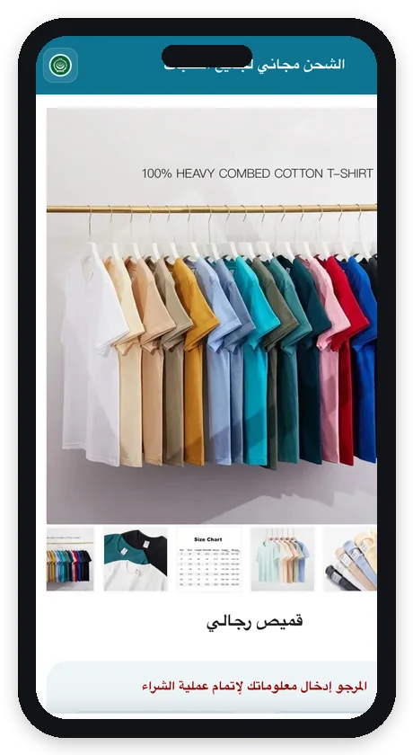
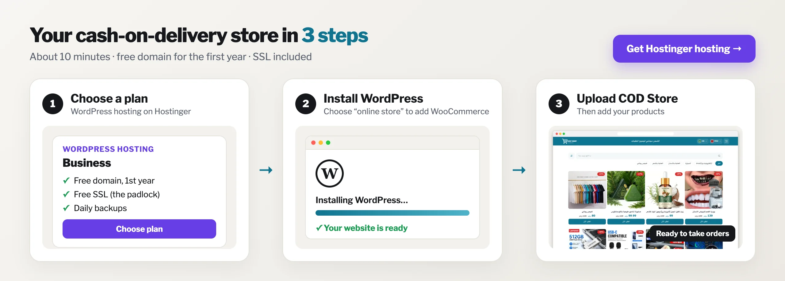

  

  
  
  
  
  

  
  
  

  <a href="https://www.cod-theme.com">Live demo</a> ·
  <a href="#-download">Download</a> ·
  <a href="#-screenshots">Screenshots</a> ·
  <a href="#-features">Features</a> ·
  <a href="#-need-hosting">Hosting</a> ·
  <a href="#-install">Install</a> ·
  <a href="#-updates">Updates</a> ·
  <a href="#-follow-nid-academy">Follow</a>

---

**COD Store** is a free, lightweight WooCommerce theme for stores that sell with **cash on delivery**. Customers order straight from the product page with a short form (name, phone, city, address) or on WhatsApp, with no cart and no checkout. It is built right-to-left for Arabic stores, with quantity offers, a currency switcher, ad pixels and everything set from the Customizer.

## ⬇ Download

**[Download hx-store.zip](https://github.com/NIDACADEMY/cod-store/releases/latest/download/hx-store.zip)** (latest release), then upload it in **Appearance → Themes → Add New → Upload Theme**.

**[See the live demo store](https://www.cod-theme.com)** to try the theme on a phone or computer.

## 🖼 Screenshots

<table>
  <tr>
    <td colspan="2"> <b>Home</b>: search, category filters and a product grid with discount badges and an order button on every card.</td>
  </tr>
  <tr>
    <td width="62%"> <b>Product page</b>: gallery, variations and the cash-on-delivery order form next to the photos.</td>
    <td width="38%" align="center"> <b>On phones</b>: made for mobile shoppers, with an order button that stays on screen.</td>
  </tr>
</table>

Screenshots from the live demo store. Product photos are not included in the theme.

## ✨ Features

| | |
|---|---|
| 🧾 **Order form on the product page** | Name, phone, city and address, with ready-made form designs. No cart, no checkout. |
| 💬 **WhatsApp ordering** | Order by form, by WhatsApp, or both: store-wide or per product. |
| 🎁 **Quantity offers** | "1 piece 99 dh, 2 pieces 180 dh" cards in the order form, priced on the server. |
| ⏱ **Price box** | Crossed-out price, discount badge, "you save" line and a countdown to the real sale end date. |
| 🛍 **Thank-you offer** | One tap adds a discounted product to the order just placed (same parcel, same payment). |
| 🎟 **Offer popup** | A coupon popup or a prize wheel, with its own design settings. |
| ⭐ **Reviews** | Stars under the title, rating breakdown, review cards and an "add your review" form. |
| 💱 **Currency switcher** | Show prices in other currencies with automatic or manual rates (orders stay in dirhams). |
| 📈 **Ad pixels** | Facebook (Meta), TikTok and Google: PageView, ViewContent, InitiateCheckout and Purchase. |
| 🧱 **Header builder** | Three rows, drag-and-drop items, separate layouts for desktop and phones. |
| 🔎 **Search and filters** | Home search bar and filter drawer, with load-more product grids. |
| ✍️ **Blog** | Blog archive, single posts and sidebar in the same style. |
| 🔄 **Updates itself** | New releases show under Dashboard → Updates. |

## 🌐 Need hosting?

COD Store runs on any WordPress site with WooCommerce. No site yet? We use **Hostinger** for our own sites.

<a href="https://www.hostinger.com/nidacademy">
  <picture>
    <source media="(prefers-color-scheme: dark)" srcset=".github/images/hosting-dark.webp">
    <source media="(prefers-color-scheme: light)" srcset=".github/images/hosting-light.webp">
    
  </picture>
</a>

<b>Show the steps</b> (about 10 minutes)

 

1. **Choose a plan.** Open [Hostinger](https://www.hostinger.com/nidacademy) and pick a **WordPress hosting** plan. *Business* is the best fit for a store: it is faster and adds daily backups.
2. **Create your account and pay.** 12 or 24 months gives the lowest monthly price.
3. **Claim your domain**, for example `yourstore.com`, or connect one you already own.
4. **Install WordPress and WooCommerce.** When asked what you want to build, choose an **online store** so WooCommerce is installed too, and skip the suggested theme. Already past this step? In hPanel go to **Websites → Add website → WordPress**, then add WooCommerce from **Plugins → Add New**.
5. **Log in** at `yourdomain.com/wp-admin` once the domain and SSL are ready (a few minutes).
6. **Install COD Store** with the steps below, then add your products.

Affiliate link: Nid Academy earns a small commission if you buy through it, at no extra cost to you.

## 🚀 Install

1. [Download `hx-store.zip`](https://github.com/NIDACADEMY/cod-store/releases/latest/download/hx-store.zip).
2. In WordPress, go to **Appearance → Themes → Add New → Upload Theme**, choose the zip, then **Install Now** and **Activate**.
3. Install and activate **WooCommerce** and add your products.
4. For the home page product grid, install **Elementor** and add the **Products Grid (Store)** widget to your home page.
5. Open **Appearance → Customize** to set the header, order form, WhatsApp number, currencies, pixels and more.

**Requirements:** WordPress 6.2+, PHP 7.4+, WooCommerce. Elementor for the home page grid. GTranslate is optional (language switcher in the menu).

## 🔄 Updates

New versions appear under **Dashboard → Updates** like any other theme. You can turn on auto-updates on the Themes page. See the [changelog](CHANGELOG.md).

## 🤝 Works well with

- **[COD Manager Pro](https://github.com/NIDACADEMY/cod-manager-pro)**: our free plugin to confirm, ship and collect cash-on-delivery orders and follow your real profit.

## 🌐 External services

- **open.er-api.com**: exchange rates, only when the currency switcher uses automatic rates.
- **Facebook, TikTok and Google** tracking scripts, only after you paste a pixel ID.
- **WhatsApp** (wa.me) links, only when WhatsApp ordering is on.

Details are in `readme.txt`.

## 📣 Follow Nid Academy

Tutorials, tips and new releases:

  
  
  

Found a bug or have an idea? [Open an issue](https://github.com/NIDACADEMY/cod-store/issues).

## 📄 License

GPL-2.0-or-later. See [LICENSE](LICENSE). Fonts: Cairo and Assistant (SIL Open Font License).

Made with care by <a href="https://www.nidacademy.org/">Nid Academy</a>

